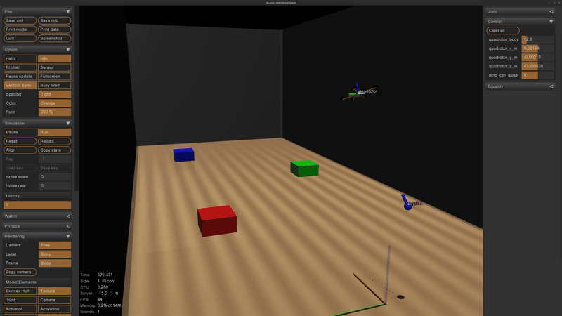

# ACP MuJoCo Payload Transportation Simulator Setup



At this point, you should have successfully installed all required **ACP Lab core packages**.

## Direct PX4 SITL ↔ MuJoCo connection through MAVLink

This optional implementation uses **PX4 v1.16.0**, commit
`6ea3539157ca358c70a515878b77077af7d4611d`. It builds `px4_sitl_default`
and keeps PX4 in the workspace's `.px4_runtime/` directory, outside the ROS
package sources. The existing acro, payload and low-level launches retain their
controllers and defaults.

MuJoCo computes the vehicle dynamics and simulated sensors. PX4 runs its
estimator, controllers and motor allocation, then sends motor commands back
to MuJoCo. The connection uses PX4's external MAVLink simulator interface:

```text
MuJoCo sensors ── HIL_SENSOR / HIL_GPS ──> PX4 SITL
MuJoCo rotors  <── HIL_ACTUATOR_CONTROLS ── PX4 SITL
```

The simulator connection and optional command client use separate ports:

| Connection | Messages | Default port, instance 0 |
| --- | --- | --- |
| Application → PX4: desired body rates and collective thrust | `SET_ATTITUDE_TARGET`, plus commands/telemetry | Application listens on UDP `127.0.0.1:14540`; PX4 uses `14580` |
| MuJoCo ↔ PX4: simulated sensors and motor outputs | `HIL_SENSOR`, `HIL_GPS`, `HIL_ACTUATOR_CONTROLS` | MuJoCo listens on TCP `127.0.0.1:4560`; PX4 connects |

Relevant PX4 source:
[MAVLink simulator](https://github.com/PX4/PX4-Autopilot/blob/v1.16.0/src/modules/simulation/simulator_mavlink/SimulatorMavlink.cpp),
[SITL MAVLink ports](https://github.com/PX4/PX4-Autopilot/blob/v1.16.0/ROMFS/px4fmu_common/init.d-posix/px4-rc.mavlink).

### Build the pinned PX4 baseline

From the ROS workspace root:

```bash
export ACP_WS="$PWD"
bash src/acp_mujoco_simulator/scripts/setup_px4_sitl.sh "$ACP_WS"
```

The setup script uses an isolated Python environment with access to the system
ROS Python packages. It requires a C/C++ build toolchain, CMake, Ninja, Git,
and either `uv` or Python's `venv` support. It downloads the SITL submodules
and Python build dependencies; it does not install system packages. The standard
PX4 build includes its DDS client, but this integration needs no DDS agent,
`px4_msgs`, MAVROS, or Gazebo.

### Build the MuJoCo bridge

Build the optional C++ runner after building PX4:

```bash
source install/setup.bash
colcon build --packages-select acp_mujoco_simulator --symlink-install \
  --cmake-args \
  -DACP_BUILD_PX4_BRIDGE=ON \
  -DMUJOCO_ROOT_DIR="$PWD/mujoco-3.10.0" \
  -DMAVLINK_INCLUDE_DIR="$PWD/.px4_runtime/PX4-Autopilot/build/px4_sitl_default/mavlink"
source install/setup.bash
```

### Start the connection

In terminal 1, from the workspace root, start the MuJoCo plant:

```bash
source install/setup.bash
ROS_DOMAIN_ID=147 ros2 launch acp_mujoco_simulator px4_mujoco.launch.py \
  mujoco_plugin_dir:="$PWD/mujoco-3.10.0/bin/mujoco_plugin" \
  run_dir:=/tmp/acp_px4_mujoco
```

In terminal 2, start PX4 with the MuJoCo parameters:

```bash
ROS_DOMAIN_ID=147 python3 src/acp_mujoco_simulator/scripts/run_px4_sitl.py \
  --px4-dir .px4_runtime/PX4-Autopilot \
  --run-dir .px4_runtime/mujoco
```

This uses PX4's `none_iris` startup as the external-simulator entry point and
overrides its rotor geometry, thrust curve, hover thrust, rate gains and sensor
configuration with `config/px4_mujoco.json`. It does not use the Iris physical
model. PX4 stores its parameters and logs in the supplied `--run-dir`.

Wait for the bridge's `lockstep active` message and PX4 readiness. The simulator
connection is now running; no command client is required to keep it connected.

Useful commands at the `pxh>` prompt:

```text
simulator_mavlink status
mavlink status
listener sensor_combined
listener actuator_outputs_sim
shutdown
```

Stop PX4 with `shutdown`, then stop the ROS launch. A disconnected or stalled
PX4 connection stops the physics runner with an explicit error.

### Optional connection and flight checks

In terminal 3, observe PX4 telemetry without arming:

```bash
.px4_runtime/python/bin/python \
  src/acp_mujoco_simulator/scripts/px4_mavlink_rates.py monitor --duration 5
```

To exercise the connection with a short body-rate command:

```bash
.px4_runtime/python/bin/python \
  src/acp_mujoco_simulator/scripts/px4_mavlink_rates.py \
  probe --arm --thrust 0.17 --axis yaw --duration 5 \
  --output /tmp/acp_mujoco_rate_probe.csv
```

The probe streams zero rates before requesting Offboard mode, checks the mode
and arm acknowledgements, commands a +0.2 then −0.2 rad/s pulse, requests PX4
landing, and disarms after PX4 reports ground contact. Thrust is fixed during
the rate probe, so altitude is not held. This uses PX4's body-rate controller
through Offboard setpoints; it does not select manual Acro mode.
Only one command client should bind a given offboard UDP port at a time.

Repeat with `--axis roll` or `--axis pitch`. Inspect the actual plant data in
`/tmp/acp_px4_mujoco/plant.csv` and PX4 telemetry in the probe CSV.

For a different port set, give PX4 `--instance 1`, launch
MuJoCo with `simulator_port:=4561`, and pass `--port 14541` before the client's
`monitor`, `probe`, or `ros` subcommand.

### Connect an existing ROS 2 outer controller

For the supplied MuJoCo model, full collective thrust is
`4 × 2.063751543951938e-6 × 3000² = 74.2950555823 N`.

```bash
source install/setup.bash
ROS_DOMAIN_ID=147 .px4_runtime/python/bin/python \
  src/acp_mujoco_simulator/scripts/px4_mavlink_rates.py \
  ros --topic /quadrotor/trpy_cmd --max-thrust 74.2950555823
```

The adapter reads `TRPYCommand.thrust` in newtons and `angular_velocity` in
body FLU rad/s. It maps rates to FRD as `[p, -q, -r]` and sends normalized
collective thrust. Publish fresh commands continuously; then use
`commander mode offboard` and `commander arm` in the PX4 console.
The adapter never arms automatically. It stops sending rate setpoints when
commands are more than 0.2 wall-clock seconds old, allowing PX4's configured
Offboard-loss action to run. It rejects nonfinite and out-of-range commands.
All ROS nodes exchanging commands must use the same ROS domain.

The thrust scaling must be changed if the plant or PX4 thrust mapping changes.

### Implementation boundaries and checks

- `scene_px4.xml.xacro` contains one quadrotor, four `RotorMotor` actuators,
  IMU/odometry publishers and `/clock`. It instantiates no `AcroMode` controller.
  The first implementation is headless; payloads, cameras and LiDAR are not
  instantiated in this dedicated scene yet.
- `mujoco_px4.cpp` exchanges sensors and actuators at 250 Hz with four 1 ms
  physics substeps. Networking runs outside MuJoCo's RK4 plugin callbacks.
  Startup freewheels until the first actuator packet, then requires an actuator
  response within two wall-clock seconds. The runner is paced at approximately
  real time and stops on a broken connection; reconnect/reset and accelerated
  runs are not implemented.
- The original rotor plant retains 18 ms command delay, a 25 ms motor time
  constant, and `f=kf*omega²`. PX4's `THR_MDL_FAC=1` applies square-root thrust
  linearization; the bridge maps its output linearly to `omega=3000*u`.
  Motor channels 1–4 correspond directly to model rotors 1–4. The configured
  FRD rotor positions and yaw torque signs match those MuJoCo sites/gears.
- The initial IMU is ideal. Accelerometers transmit specific force, with no
  second gravity subtraction. GPS is derived from ground truth at a fixed
  Zurich origin. Magnetometer data use an approximate fixed world magnetic
  field with 0.5 mGauss RMS noise. Barometric pressure includes 1 Pa RMS noise.
  The random seed is 42; perfectly constant ideal magnetic/pressure readings
  otherwise trigger PX4's stuck-sensor detectors.
  Ground-truth attitude is not injected into PX4's estimator.
- The rate gains are an initial simulation baseline, not a completed tuning
  exercise or hardware configuration.

Run the behavioral wire/physics checks with:

```bash
source install/setup.bash
.px4_runtime/python/bin/python \
  src/acp_mujoco_simulator/scripts/test_px4_bridge.py \
  --plugins "$PWD/mujoco-3.10.0/bin/mujoco_plugin"
```

These use a fake PX4 TCP peer to check stationary IMU signs, timestamp
progression, each physical rotor's torque signs, disarmed motor suppression,
fragmented MAVLink frames, nonfinite commands, disconnects and actuator timeouts.
The optional MuJoCo flight probe above exercises the real PX4 executable.

Validated with the pinned PX4 build and MuJoCo 3.10.0: all nine bridge checks
passed. A five-second pitch probe commanded +0.2 and −0.2 rad/s and measured
approximately +0.193 and −0.190 rad/s during the settled parts of each pulse.
PX4 completed takeoff, landing and disarming through the direct connection.

To use the **ACP MuJoCo Simulator** for payload transportation, we recommend creating a **dedicated ROS 2 workspace**:

```text
payload_transportation_ws
```

---

## Optional environment contacts in acro scenes

The acro launch files in `acp_autonomy` expose
`enable_environment_contacts:=true|false` (default `true`). Setting it to `false`
disables collisions with static environment geometry: floor, walls, ceiling,
boxes, pillars, and gates. Geometry remains visible; bodies can pass through it.
Contacts between moving bodies and tendon limits used for cables are unchanged.

```bash
ros2 launch acp_autonomy single_quadrotor_payload_nmpc_acro_simulation_mujoco.launch.py \
  quad_name:=eagle11 init_z:=1.5 payload_x:=0.0 payload_z:=0.5 \
  enable_environment_contacts:=false
```

The option is passed to the scene Xacro, which sets both `contype` and
`conaffinity` to zero for the `environment` geometry class. New static obstacles
should use `class="environment"` to follow this setting. The older dedicated
gate scene has explicit contact masks, so it also sets its gate mask to zero
when the option is false. When true, its separate `gates_collide` option keeps
its existing meaning. No global contact or constraint disable flag is used.

This applies to the single quadrotor acro, payload, gate, and LiDAR scenes and
the multiple quadrotor point-mass scenes. It works with both the viewer and
headless executable because both load the generated MJCF model. No C++ parameter
or headless executable change is needed.

## Optional payload gate

The payload launches, with or without LiDAR, have `enable_gate:=false` by default. Enable it with:

```bash
ros2 launch acp_autonomy single_quadrotor_payload_nmpc_acro_simulation_mujoco.launch.py \
  quad_name:=eagle11 \
  init_x:=0.0 init_y:=0.0 init_z:=1.5 \
  payload_x:=0.0 payload_y:=0.0 payload_z:=0.5 \
  enable_gate:=true
```

The simulator gate is centered at (2.0, 0.0, 2.0) m, matching the planner's
gate position in world coordinates.
Its clear opening radius is 0.40 m, also matching the planner.

| Launch argument | Default | Meaning |
| --- | --- | --- |
| `gate_x`, `gate_y`, `gate_z` | `2.0`, `0.0`, `2.0` | Opening center in world coordinates, metres |
| `gate_radius` | `0.4` | Clear opening radius, metres (0.8 m diameter) |
| `gate_thickness` | `0.1` | Full gate depth along the world x axis, metres |
| `enable_second_gate` | `false` | Add a second gate independently of `enable_gate` |
| `second_gate_x`, `second_gate_y`, `second_gate_z` | `3.5`, `0.0`, `2.0` | Second opening center in world coordinates, metres |
| `second_gate_radius` | `0.4` | Second clear opening radius, metres |
| `second_gate_thickness` | `0.1` | Second full gate depth along world x, metres |

These are launch defaults, not values read automatically from the planner.
If you change the planner's gate, pass the corresponding values here too.

For the `multiple_gates_x3p5.csv` trajectory, enable both gates. They are centered at
(2.0, 0.0, 2.0) m and (3.5, 0.0, 2.0) m:

```bash
ros2 launch acp_autonomy single_quadrotor_payload_nmpc_acro_simulation_mujoco.launch.py \
  quad_name:=eagle11 \
  init_x:=0.0 init_y:=0.0 init_z:=1.5 \
  payload_x:=0.0 payload_y:=0.0 payload_z:=0.5 \
  enable_gate:=true enable_second_gate:=true
```

The orange ring is static, with its opening in the world yz plane. It uses
64 capsule segments with a chord correction to preserve the clear radius.
It represents a finite, rounded ring; the planner uses a wall slab with a
circular opening. The planner's body radii and clearance margins constrain
body centers and do not shrink the simulator's opening.

The ring follows `enable_environment_contacts`: contacts are enabled by
default; setting it to `false` keeps the gate visible without collisions.
Each gate's enable flag removes its ring when false. After adding this macro to an
existing workspace, install it with:

```bash
colcon build --packages-select acp_mujoco_simulator acp_autonomy --symlink-install
source install/setup.bash
```

## Payload simulation with LiDAR

The payload LiDAR launch accepts the same arguments and defaults as the payload launch
above, including initial poses, masses, inertia, cable length, both gates,
sensor rates, and headless duration:

```bash
source install/setup.bash
ros2 launch acp_autonomy single_quadrotor_payload_nmpc_acro_lidar_simulation_mujoco.launch.py \
  quad_name:=eagle11 headless:=false \
  init_x:=0.0 init_y:=0.0 init_z:=1.5 \
  payload_x:=0.0 payload_y:=0.0 payload_z:=0.5 \
  enable_gate:=true enable_second_gate:=true second_gate_x:=3.5
```

This launch runs a scene with one payload attached to the quadrotor.
It retains the LiDAR environment and publishes Livox measurements on
`/eagle11/livox/lidar` (`lidar_hz:=10` by default). The simulated quadrotor
odometry remains ground truth; a separate LiDAR odometry estimator must process
the LiDAR and IMU measurements to supply estimated odometry to TI-MPC/TI-MHE.
This launch does not change controller or estimator parameters or subscriptions.

The LiDAR scene retains its walls, landmarks, and ceiling. The ceiling underside
is at z = 2.96 m; these obstacles also participate in collisions when
`enable_environment_contacts:=true` (the default).

Both gates are disabled by default. `duration_s` only stops headless runs;
use `headless:=true duration_s:=10.0` for a ten-second simulation.

## 1. Create and Configure the Workspace

Create the workspace directory (the location is up to you) and export it as an environment variable.

### Edit your `~/.bashrc`

```bash
vim ~/.bashrc
```

Add the following line (adjust the path if needed):

```bash
export COLCON_WS_DIR="$HOME/payload_transportation_ws"
```

Reload your environment:

```bash
source ~/.bashrc
```

> **Note**
> `~/payload_transportation_ws` is only an example. Ensure this path matches the actual location of your workspace.

---

## 2. Create the Setup Script

Navigate to your workspace:

```bash
cd $COLCON_WS_DIR
```

Create a setup script:

```bash
vim setup_acp_payload_transportation_simulator.sh
```

Paste the following content:

```bash
#!/bin/bash
set -e

mkdir -p src
cd src

# Start SSH agent and add key
eval "$(ssh-agent -s)"
ssh-add ~/.ssh/id_ed25519

# ACP autonomy stack
if [ ! -d "acp-autonomy-stack" ]; then
  git clone git@github.com:acp-lab/acp-autonomy-stack.git
  pushd acp-autonomy-stack
  git checkout payload_transportation_simulator
  popd
fi

# Quadrotor control
if [ ! -d "acp-quadrotor-control" ]; then
  git clone git@github.com:acp-lab/acp-quadrotor-control.git
  pushd acp-quadrotor-control
  git checkout payload_transportation_simulator
  popd
fi

# DQ-NMPC
if [ ! -d "dq_nmpc" ]; then
  git clone git@github.com:acp-lab/dq_nmpc.git
  pushd dq_nmpc
  git checkout payload_transportation_simulator
  popd
fi

# Raspberry Pi ROS 2 interface
if [ ! -d "pi_ros2_interface" ]; then
  git clone git@github.com:acp-lab/pi_ros2_interface.git
  pushd pi_ros2_interface
  git checkout main
  popd
fi

# ACP MuJoCo simulator
if [ ! -d "acp_mujoco_simulator" ]; then
  git clone git@github.com:acp-lab/acp_mujoco_simulator.git
  pushd acp_mujoco_simulator
  git checkout payload_transportation_simulator
  popd
fi

cd ..

# Build workspace
source /opt/ros/humble/setup.bash
colcon build --symlink-install --cmake-args -DCMAKE_BUILD_TYPE=Release
source install/setup.bash
```

---

## 3. Make the Script Executable

```bash
chmod +x setup_acp_payload_transportation_simulator.sh
```

---

## 4. Run the Setup Script

From inside your workspace:

```bash
cd $COLCON_WS_DIR
source setup_acp_payload_transportation_simulator.sh
```

This will clone all required repositories and build the workspace.

---

## 5. Build DQ-NMPC (Base Controller)

To build and use **DQ-NMPC** as the base controller for payload transportation:

```bash
cd $COLCON_WS_DIR/src

# Clone dual-quaternion C++ library
git clone git@github.com:acp-lab/dq_cpp.git
cd dq_cpp
git checkout payload_transportation_simulator

# Build DQ-NMPC for onboard usage
cd $COLCON_WS_DIR/src/dq_nmpc
chmod +x build_dq_nmpc_onboard.sh
source build_dq_nmpc_onboard.sh
```

When prompted for the platform type, enter:

```text
eagle
```

> **Note**
> Ensure all dependencies are installed and that the `dq_nmpc` repository was cloned in the previous steps.

---

## 6. Install MuJoCo

We use the **latest stable MuJoCo version** available at the time of this project.

From inside your workspace:

```bash
cd $COLCON_WS_DIR
```

Download and extract MuJoCo:

```bash
curl -L -o mujoco-3.4.0-linux-x86_64.tar.gz \
https://github.com/google-deepmind/mujoco/releases/download/3.4.0/mujoco-3.4.0-linux-x86_64.tar.gz

tar -xzf mujoco-3.4.0-linux-x86_64.tar.gz
rm mujoco-3.4.0-linux-x86_64.tar.gz
```

Clone MuJoCo ROS utilities:

```bash
cd $COLCON_WS_DIR/src
git clone git@github.com:acp-lab/MujocoRosUtils.git
cd MujocoRosUtils
git checkout payload_transportation_simulator
```

Build the MuJoCo ROS utilities:

```bash
cd $COLCON_WS_DIR
colcon build \
  --packages-select mujoco_ros_utils \
  --cmake-args \
    -DCMAKE_BUILD_TYPE=RelWithDebInfo \
    -DMUJOCO_ROOT_DIR=$COLCON_WS_DIR/mujoco-3.4.0

source install/setup.bash
```

---

## 7. Run the Simulator

### Start the MuJoCo simulator

```bash
cd $COLCON_WS_DIR
source install/setup.bash
ros2 launch acp_autonomy single_quadrotor_mujoco_sim.launch.py
```

### Start MAV manager

```bash
ros2 run mav_manager mav_manager_service_exec
```

### Run trajectory manager tests

```bash
ros2 run mav_manager_test main_test
```

### Payload initial pose, physical parameters, and headless duration

The payload simulation launch accepts the quadrotor's initial position and
orientation, the payload's initial position, physical parameters, and an optional
headless duration:

```bash
ros2 launch acp_autonomy single_quadrotor_payload_nmpc_acro_simulation_mujoco.launch.py \
  quad_name:=eagle11 headless:=true duration_s:=20.0 \
  init_roll:=0.0 init_pitch:=0.0 \
  payload_x:=-0.7 payload_y:=0.0 payload_z:=0.02
```

| Argument | Default | Meaning |
|---|---|---|
| `init_x`, `init_y`, `init_z` | `0.0`, `0.0`, `0.03` | Quadrotor body-origin position in world coordinates, metres |
| `init_roll`, `init_pitch`, `init_yaw` | `0.0`, `0.0`, `0.0` | Initial quadrotor Euler angles, radians |
| `payload_x`, `payload_y`, `payload_z` | `-0.7`, `0.0`, `0.02` | Initial payload position in world coordinates, metres |
| `quadrotor_mass` | `1.24` | Quadrotor mass, kg |
| `quadrotor_ixx` | `0.0027338143976` | Quadrotor inertia about the body x-axis through its CoM, kg m² |
| `quadrotor_iyy` | `0.0027336327812` | Quadrotor inertia about the body y-axis through its CoM, kg m² |
| `quadrotor_izz` | `0.0052991944907` | Quadrotor inertia about the body z-axis through its CoM, kg m² |
| `payload_mass` | `0.2` | Mass of the cable-connected payload, kg |
| `cable_length` | `0.95` | Maximum tendon length between attachment sites, metres |
| `duration_s` | `0.0` | Headless simulation duration in simulated seconds; zero runs until stopped |

Pose and physical arguments apply to both graphical and headless runs. `duration_s` applies
only with `headless:=true` and must be finite and nonnegative. The simulator
stops at the first completed physics step reaching the requested duration, so
the endpoint has physics-timestep resolution. Existing launches that omit
`duration_s` continue running until stopped.

For example, to change the plant parameters:

```bash
ros2 launch acp_autonomy single_quadrotor_payload_nmpc_acro_simulation_mujoco.launch.py \
  quad_name:=eagle11 headless:=true duration_s:=20.0 \
  quadrotor_mass:=1.5 \
  quadrotor_ixx:=0.0035 quadrotor_iyy:=0.0035 quadrotor_izz:=0.006 \
  payload_mass:=0.3 cable_length:=1.2
```

The inertia remains diagonal: `diag(Ixx, Iyy, Izz)`. Mass and inertia are
independent inputs; changing `quadrotor_mass` does not rescale the inertia.
These arguments configure the MuJoCo plant. Controller model parameters remain
configured separately, so use matching values there for nominal-model experiments.
The single-payload scenes, with or without LiDAR, attach the cable 5 cm below the quadrotor
body origin (`payload_site_pos="0.0 0.0 -0.05"`). With a level quadrotor,
`init_z:=1.5`, `payload_z:=0.5`, and equal x/y coordinates, the initial
attachment-to-payload distance is `1.5 - 0.05 - 0.5 = 0.95 m`, matching the
default cable length.

Changing `cable_length` sets the tendon limit; initial positions remain the values
supplied through the pose arguments.
